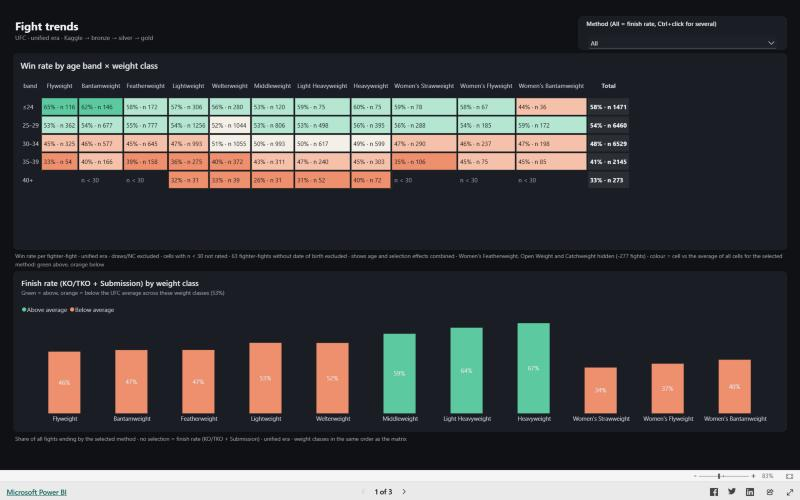
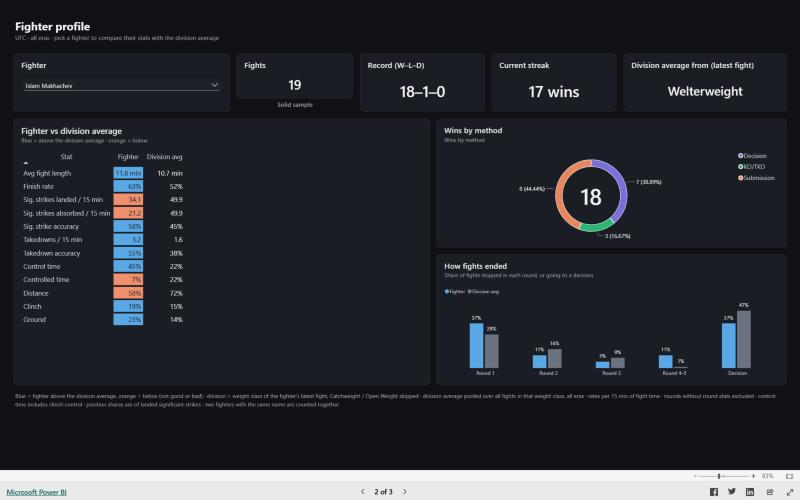
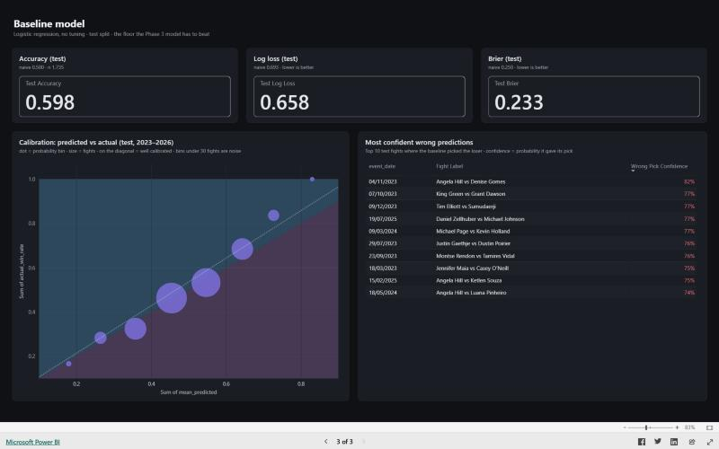

# Combat Sports Data Platform

An end-to-end **fight-outcome forecasting platform** built in Microsoft Fabric. Raw fight data goes in one end; a Power BI report with descriptive trends, fighter profiles and a calibrated baseline model comes out the other. UFC/MMA is the first data set; the platform is built so a source can be swapped without touching anything downstream.

```
Kaggle (history) ─┐
Kaggle gap fill ──┼─► bronze ──► silver ──► gold (star schema) ──► baseline model ──► Power BI
Cito API (weekly) ┘   raw, as-is  one source-   fact_round +         logistic          3 pages
                                  free contract  4 dimensions         regression
        └──────────── scheduled Fabric pipeline, weekly, push alert on failure ────────────┘
```

**Live report:** [open the Power BI report](https://app.fabric.microsoft.com/view?r=eyJrIjoiM2RmM2NjZDYtMWY3NC00YjUyLTg5NzctNTFlYWUwMTg0MDZhIiwidCI6IjA1ZWIyMWFjLTIwNWYtNDQ5Zi1hYjlkLTE3YjM0YzdhYzc3ZCJ9) (public, no sign-in)

## Where it stands

| Phase | What | Status |
|---|---|---|
| **1** | Platform on Kaggle data → Power BI + baseline model | **Built** (17 Oct 2026) |
| **2** | Live source loaded incrementally into the same silver contract — same gold, same report | **Built** (4 Nov 2026) |
| 3 | Real model: rating system + logistic regression, scored on calibration, benchmarked against closing odds | In progress (target 29 Nov 2026) |

## In numbers

- **8,818 fights**, 795 events, 2,768 fighters → `fact_round` at **fighter × round** grain (41,400 rows, 0 orphan keys).
- Three sources, one contract: Kaggle history up to 16 May 2026, a second Kaggle scrape to fill the gap to the API window, and the **Cito API** going forward.
- **Baseline model** — logistic regression, no tuning, on record, age, age gap, layoff, weight class, reach/height differential. Trained on fights before 2023, tested on 1,735 fights from 2023-01-01 to 2026-05-16:

| Metric (test) | Baseline | Coin flip |
|---|---|---|
| Accuracy | **0.598** | 0.500 |
| Log loss | **0.658** | 0.693 |
| Brier | **0.233** | 0.250 |

  This is deliberately simple and barely predictive. It is **the floor the Phase 3 model has to beat**. Calibration is close: bins holding 96 % of test fights land within 1–4 pp of the diagonal.

## Phase 2: the source switch

The test of the design: add a live source without changing anything downstream of silver.

- **Cito API** → `10_ingest_cito` stores raw JSON in bronze; `20_clean_cito` maps it to the silver contract and `MERGE`s on natural key, so late corrections from the source update rows instead of duplicating them.
- **Entity resolution without IDs.** Cito has no UFCStats fighter IDs; fighters are matched on normalised names. All **124 matches confirmed** against a second source (62 / 62 overlapping fights).
- **Reconciliation.** On the 5 overlapping events, Cito and the Kaggle scrape show **0 disagreements** on 11 fight columns. One fight was traced by hand from silver to `fact_round` against its ufcstats.com page: all values equal.
- **Downstream changes needed:** an overlap rule in gold (one copy per fight) and removing Kaggle-only hard-coded expectations. **No column, type or key change; none in Power BI.** Full list and coverage in [`data-coverage.md`](docs/data-coverage.md).
- **Scheduled pipeline.** `pipeline_cito_refresh` runs `10_ingest_cito → 20_clean_cito → 30_warehouse_dims → 30_warehouse_fact_round` every Monday. Notebooks raise on silent failures (non-200 API calls, stale fighter IDs), and any failed or skipped step sends a push alert. Tested with a real failure. API keys live in Azure Key Vault, never in code.

## The report

- **Fight trends** — win rate by age band × weight class, and the share of fights ending by KO/TKO, submission or decision per weight class. A method selector drives both; colours show each cell against the UFC average.
- **Fighter** — search any fighter: record, current streak, sample-size warning, and 12 stats against their division average (pace, accuracy, takedowns, control time, where strikes land), plus wins by method and how their fights ended.
- **Baseline model** — test metrics vs. naive, calibration plot, and the model's most confident wrong predictions.

*Screenshots (Nov 2026). The [live report](https://app.fabric.microsoft.com/view?r=eyJrIjoiM2RmM2NjZDYtMWY3NC00YjUyLTg5NzctNTFlYWUwMTg0MDZhIiwidCI6IjA1ZWIyMWFjLTIwNWYtNDQ5Zi1hYjlkLTE3YjM0YzdhYzc3ZCJ9) is interactive.*







## Design choices worth knowing

- **Medallion layers.** `bronze_` is raw and append-only. `silv_` is cleaned to the [silver contract](docs/silver-contract.md). Gold is the star schema.
- **Source-swap contract.** Silver is source-agnostic: source-specific column names live only in that source's `20_clean_*` notebook, and nothing downstream of silver reads bronze. Phase 2 tested this for real.
- **Star schema.** `fact_round` with `dim_fight`, `dim_fighter`, `dim_event`, `dim_date`. `dim_fighter` is SCD Type 1 for now — time-varying attributes (weight class, age at fight) live at fight grain ([why](docs/decisions.md)).
- **No leakage in the model.** Fighter A vs B is assigned by a stable hash of the fight key, not by corner (corner 1 wins 64 %), and the split is by date.

## What went wrong, and how it was caught

The failures are the useful part. Each one is now guarded; details in [`decisions.md`](docs/decisions.md) and [`data-coverage.md`](docs/data-coverage.md).

- **One fighter, two identities: an invisible apostrophe.** Kaggle writes `Lone'er` with a straight apostrophe, Cito with a curly one. Name normalisation dropped the second, so the names never matched and a second fighter was created. Caught by a count of Cito-only fighter IDs in gold (2 where 0 was expected).
- **A fight missing from the API.** Cito silently lacked one fight for a week. Found only because the Kaggle scrape overlapped; it arrived later and the incremental `MERGE` picked it up with no manual step. Lesson: once Cito is the only source, completeness can't be checked.
- **Silver writes pointed at the wrong table.** All four writes targeted the same table, so three tables silently stopped refreshing. A row count couldn't see it; Delta's own `replaceWhere` guard did.
- **A notebook that passes interactively can fail in the pipeline.** Leftover session variables hid two bugs. Rule since: stop the session, then Run all, before calling a notebook done.
- **Publish to web refused the report** with an error that named neither cause: Direct Lake defaults to single sign-on, which anonymous viewers can't use. Fix: a fixed-identity connection on the semantic model.
- **Report measures stored as `SYNTAXERROR`.** Two causes, same symptom: an apostrophe inside a DAX comment, and a variable named `lastDate`, which clashes with the `LASTDATE` function.
- **An average compared each bar with itself.** Visuals sorted by weight class also group by its sort-order column, so the "UFC average" kept that filter. Fix: clear the sort column too.

## Repo layout

```
├── Fabric/                          # Fabric items, synced via Git integration
│   ├── 10_ingest_kaggle / _kagglesk / _cito     # bronze
│   ├── 11_explore_*                             # source exploration (throwaway)
│   ├── 20_clean_kaggle / _kagglesk / _cito      # silver (source column names live only here)
│   ├── 21_reconcile_sources                     # cross-source disagreement counts
│   ├── 30_warehouse_dims, 30_warehouse_fact_round   # gold
│   ├── 40_model_baseline                        # baseline model → predictions, metrics, calibration
│   ├── 90_alert_email                           # push alert on pipeline failure (ntfy)
│   ├── pipeline_cito_refresh.DataPipeline       # weekly schedule
│   ├── sm_combat_sports.SemanticModel           # Direct Lake model + measures
│   ├── DB_Fight_Stats_by_Weightclass.Report     # the Power BI report
│   ├── bronze_layer / silver_layer / gold_layer # one lakehouse per layer (definitions only, no data)
│   └── Test_, pySpark_learning, Bronze_Check    # scratch items from learning Fabric, not part of the pipeline
└── docs/
    ├── project-definition.md   # scope, phases, gates (source of truth)
    ├── build-plan.md           # what gets built when
    ├── silver-contract.md      # source-agnostic silver schema
    ├── data-coverage.md        # source coverage, reconciliation, failures
    ├── decisions.md            # dated decision log
    └── ideas.md                # capture list, not in scope
```

## Data sources

All three sources go back to [UFCStats](http://ufcstats.com) data. None is scraped by this project; ufcstats.com's terms forbid automated access, so it isn't scraped directly either.

- **Kaggle, history to 16 May 2026:** [jerzyszocik/ufc-fight-forecast-complete-gold-modeling-dataset](https://www.kaggle.com/datasets/jerzyszocik/ufc-fight-forecast-complete-gold-modeling-dataset).
- **Kaggle, gap fill 16 May → Oct 2026:** [scarekrow/ufc-data](https://www.kaggle.com/datasets/scarekrow/ufc-data).
- **Cito API, ongoing:** [citoapi.com](https://citoapi.com), free tier. Cito describes its data as aggregated from public sources and not rights-cleared.

No raw data is stored in this repo. It holds code and item definitions only.

## Run it

The pipeline `pipeline_cito_refresh` runs weekly (Monday 12:00, Copenhagen) with a 35-day lookback; `lookback_days = -1` forces a full refresh. To rebuild by hand, run `10 → 20 → 30_warehouse_dims → 30_warehouse_fact_round → 40` in the Fabric workspace and refresh the semantic model. Kaggle files land under `Files/kaggle_file_load/<load_id>/` in the bronze lakehouse; `data/` is gitignored because the Kaggle pulls are reproducible.

---

*Framing: this is a forecasting-methodology project — calibration and honest evaluation, not a betting system.*
