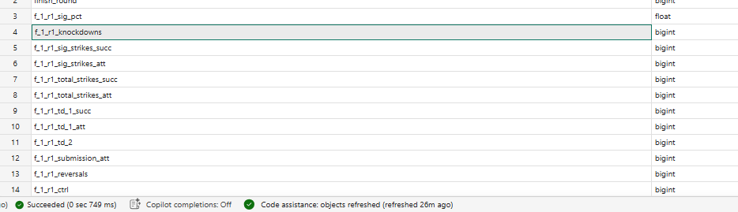
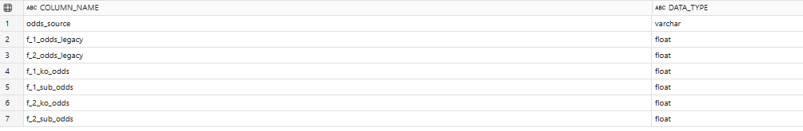
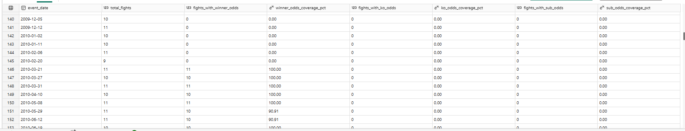
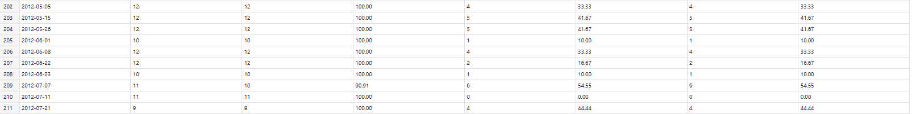
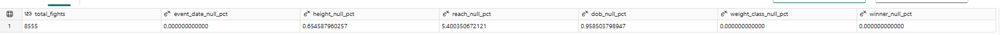
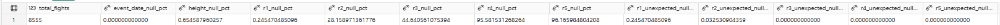
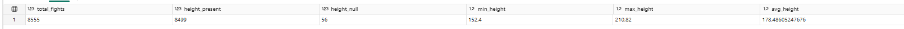

# Data Coverage — Kaggle bronze, kagglesk and Cito

Part 1 (below) profiles the original Kaggle load (Phase 1). [Part 2](#part-2--phase-2-sources-and-the-overlap-reconciliation) covers the Phase 2 sources after 2026-05-16 and the cross-source reconciliation.

*Source: `bronze_kaggle_full_data_silver_plus` · load `2026-09-24` · profiled 2026-09-25/26 in the `bronze_layer` SQL analytics endpoint (queries not yet saved to `11_explore_kaggle`)*

*Dataset: [jerzyszocik/ufc-fight-forecast-complete-gold-modeling-dataset](https://www.kaggle.com/datasets/jerzyszocik/ufc-fight-forecast-complete-gold-modeling-dataset) (files `full_data_silver_plus.parquet`, `ufc_features.parquet`; last updated 2026-06-10 per the Kaggle API, 2026-10-18). A different maintainer's dataset in the same format, [scarekrow/ufc-data](https://www.kaggle.com/datasets/scarekrow/ufc-data), runs through 2026-10-10 (8,937 fights / 793 events, `UFC_full_data_silver_v2.csv`, 361 columns).*

What the Kaggle data actually contains, in plain numbers. It answers one question for Sprint 1 — can we build a table with one row per round? — and feeds the silver contract in Sprint 2.

Counts marked *(derived)* are computed from a null % in the screenshots × 8,555 fights, not queried directly.

## Verdict

**Can this dataset support a `fact_round` grain?** **Yes** — 8,534 of 8,555 fights (99.75 %) have per-round stats.

The 21 fights without round-1 stats are totals-only and stay out of `fact_round`.

## Volume

| Metric | Value | What it tells us |
|---|---|---|
| Date range | 1994-03-11 (UFC 2) → 2026-05-16 | Matches expectations. UFC 1 is not in the data (excluded anyway, decisions.md 2026-09-24). Phase 2 fills in after 2026-05-16. |
| Rows | 8,555 | One row per fight. |
| Distinct fights (`fight_url`) | 8,555 | Equals Rows — no duplicate fights. |
| Fights with per-round detail | 8,534 *(derived)* | Per-round columns follow `f_<corner>_r<round>_<stat>` (e.g. `f_1_r1_sig_strikes_succ`), covering knockdowns, significant/total strikes, takedowns, submission attempts, reversals and control time, for rounds 1–5. |
| Fights with totals only | 21 *(derived)* | `r1` null on 0.245 % of fights. |
| Total rounds (sum of rounds fought) | *not queried* | `SUM(finish_round)` over the 8,534 fights. Use `finish_round` (round the fight ended), not `num_rounds` (scheduled 3 or 5). |

## Identity (source-swap check)

| Question | Answer | What it tells us |
|---|---|---|
| UFCStats fight IDs | **Yes** — `fight_url` | `fight_url` = `ufcstats.com/fight-details/<id>`. Fight key solved. |
| UFCStats fighter IDs/URLs | **Yes** — fighter URL for both corners | Fighter URL becomes the `dim_fighter` natural key; most of Sprint 3's entity resolution gets easy. It also anchors fighter profiles (attributes per fighter) — which is what `dim_fighter` is. |

## Odds

Only used in Phase 3 as the benchmark the model is compared against — never as a model input.

Odds columns: `odds_source`, `f_1_odds_legacy` / `f_2_odds_legacy` (winner), `f_1_ko_odds` / `f_2_ko_odds`, `f_1_sub_odds` / `f_2_sub_odds`.

| Metric | Value | What it tells us |
|---|---|---|
| Fights with winner odds | *not queried* (≈ 90–100 % of fights per event from 2010-03) | How many fights the market benchmark can be run on. |
| Earliest date with winner odds | 2010-03-21 *(from the screenshot; rows before 2009-12 not checked)* | The benchmark covers 2010-03 onwards. |
| KO / submission odds | Sporadic from 2012 (10–55 % of fights per event); 80–100 % from ~2014 | Method odds. Not needed for the Phase 3 benchmark. |
| Opening or closing odds? | *open* — check `SELECT DISTINCT odds_source` and what "legacy" means | The Phase 3 benchmark is specified against closing odds. |

Emil's view: the odds here are too coarse. Method, round-of-finish and over/under odds are needed for measurements that are actually useful; they could come from elsewhere (e.g. BestFightOdds). Parked — see decisions.md 2026-09-26.

## Null rates (columns that matter)

| Column | Null % | Null fights *(derived)* | Note |
|---|---|---|---|
| `event_date` | 0.00 % | 0 | |
| `weight_class` | 0.00 % | 0 | |
| `winner` | 0.00 % | 0 | Suspicious — see "looks wrong" #3. |
| height | 0.65 % | 56 | Range 152.4–210.8 cm, avg 178.5 cm. Stored in cm. |
| reach | 5.40 % | 462 | Highest null rate. Cannot be a required column; the model needs a missing-reach strategy. |
| date of birth | 0.96 % | 82 | Needed for age. |
| method | *not queried* | | |
| round 1 stats | 0.25 % | 21 | All of them unexpected — every fight has a round 1. |
| round 2 stats | 28.16 % | | Mostly fights that ended in R1; 0.03 % unexpected. |
| round 3 stats | 44.64 % | | 0 unexpected. |
| round 4 stats | 95.58 % | | 0 unexpected. |
| round 5 stats | 96.17 % | | 0 unexpected. |

"Unexpected" = null although the fight lasted into that round (`finish_round` ≥ n). That separates *fight ended early* from *data missing*.

## Other checks

| Check | Answer | What it tells us |
|---|---|---|
| DWCS events in Kaggle | **No** — `event_name` has no `Contender` / `DWCS` | DWCS stays parked with the other orgs (decisions.md 2026-09-24). Could still be a later data source. |
| Newer Kaggle version than 2026-05-16 | **No** (checked 2026-09-26) | Phase 2 has the full gap to fill. |

## First three things that look wrong

Each becomes a rule in `20_clean_kaggle`.

1. **21 fights have no round stats at all** (r1 null). Exclude from `fact_round`; keep in the fight-level tables.
2. **2 fights miss round-2 stats although they lasted into round 2** *(derived: 0.0325 % of the ~6,148 fights that reached R2)*. Decide: drop the fight from `fact_round`, or keep the rounds that exist and flag it.
3. **`winner` is never null**, but draws and no-contests exist in MMA. Check what value those fights carry in `winner`. If it is one of the fighters' names, that is a data error.

Not problems: many stats stored as `bigint` (fine for counts; control time is presumably seconds), height in cm / weight in lbs (units are consistent — convert or label in silver).

## Conclusion

The dataset supports `fact_round`: 99.75 % of fights have round-level stats, fight and fighter UFCStats IDs are present, and the attribute columns are near-complete except reach (5.4 % null). Winner odds cover 2010 onwards, which is enough for the Phase 3 benchmark. Richer odds markets are parked.

**Still open:** total rounds count, exact winner-odds fight count, `method` null rate, `odds_source` values (opening vs. closing).

---

# Part 2 — Phase 2 sources and the overlap reconciliation

*Checked 2026-10-22 → 24 in a kagglesk exploration notebook (bronze; deleted since — its results are recorded here and in `decisions.md`) and `21_reconcile_sources` (silver). Details and dates per finding in `decisions.md`.*

Phase 2 replaces the static Kaggle load with a live source (Cito API) and fills the gap in between from a second Kaggle dataset. Three sources now feed the same silver tables, each tagged by `source`:

| `source` | Dataset | Covers in silver | Keys | Silver rows (event / fight / round / new fighters) |
|---|---|---|---|---|
| `kaggle` | jerzyszocik (parquet) | 1994 → 2026-05-16 | UFCStats IDs | 774 / 8,555 / 20,145 / 2,686 |
| `kagglesk` | [scarekrow/ufc-data](https://www.kaggle.com/datasets/scarekrow/ufc-data) (CSV) | 2026-05-16 → 2026-10-17 (the gap) | UFCStats IDs | 20 / 249 / 524 / 81 |
| `cito` | Cito API, free tier (JSON) | 2026-09-19 → today, incremental | event = UFCStats ID; fights `cito_…`; fighters via name match | 5 / 62 / 126 / 0 |

Run order: `20_clean_kaggle` → `20_clean_kagglesk` → `20_clean_cito`. Each writes only its own rows (`replaceWhere "source = '…'"`), and Cito goes last because it matches its fighters against everything already in silver.

## kagglesk vs jerzyszocik (bronze, before cleaning)

The question: can `20_clean_kaggle` be reused for kagglesk, or does it need its own logic?

| Check | Result | What it tells us |
|---|---|---|
| Fights | 8,950 distinct; **all 8,555 jerzyszocik fights included** + 249 after 16 May + 146 older fights jerzyszocik lacks | kagglesk is a superset; only fights after 16 May go to silver. |
| Columns | 359 of 361 names identical; 8 odds columns missing, `f_1_odds`/`f_2_odds` new | Same format → `20_clean_kagglesk` is a copy of `20_clean_kaggle` with a date filter. |
| Round stats (5,495 fights with the same fighter in corner 1) | **Identical** in every round-stat column except control time | Same underlying scrape; round data can be trusted. |
| Control time | ±1 s on ~1,300–1,700 fights | Rounding in the m:ss → seconds conversion. Negligible. |
| Corners | f1/f2 assigned independently per source (2,996 fights swapped) | Never compare `f_1_*` across sources without aligning fighters first. |
| Career stats, record, profile | Differ for active fighters | Scrape-date snapshots refreshed by the July re-scrape, not as-of the fight. |
| Corrections | `result` "Overturned", finer decision types, `title_fight` (11), `winner` (16) | The newer scrape is more correct. |
| Odds, ranking | Method odds absent; `ranking` filled differently (28 % / 16 % of fights) | Both left **null** in silver for kagglesk: odds not carried, ranking's as-of date unknown (leakage risk). Raw values kept in bronze. |

## kagglesk vs Cito (silver, after cleaning)

The two sources overlap on 5 events (2026-09-19 → 10-17). Both copies are kept in silver; gold keeps one per fight. Compared in silver, so both sides already speak the silver contract — no source column names involved.

Match key: `event_id` + the two fighter IDs in either corner (`LEAST`/`GREATEST`). Fight IDs differ per source, and each source orders corners its own way.

| Check | Result | What it tells us |
|---|---|---|
| Fights matched | **62 / 62** Cito fights match a kagglesk fight | All **124 Cito name matches confirmed** against UFCStats IDs. Cito has no fighter IDs, so this is the only independent test of that entity resolution. |
| Fights missing | **1 of 63**: Nate Landwehr vs Mandel Nallo (2026-10-17) absent from Cito | Not in any Cito response (19 Oct and 24 Oct snapshots), though the fight happened. Query to Cito drafted 2026-10-24. |
| Fight columns (11: outcome, winner, method, decision type, finish round/time, weight class, title fight, gender, scheduled rounds, referee) | **0 disagreements** | Cito and UFCStats agree on what happened. `scheduled_rounds` is null on all Cito rows (no such field). |

## What went wrong, and how it was caught

The failures are the useful part. Each one is now guarded.

1. **CSV read without `multiLine`** — 270 kagglesk fights split across two rows at a line break inside `result_details`, showing up as ~270 "extra" rows and fake duplicates. Caught by `COUNT(*)` vs `COUNT(DISTINCT fight_url)` and an unparseable-date count. Fix: `multiLine` + `escape`; reload gives 8,950 = 8,950 distinct.
2. **Silver writes pointed at the wrong table** — after the `replaceWhere` switch, all four writes in `20_clean_kaggle` targeted `silv_event`, so fights, rounds and fighters were silently not refreshed. A row count per source couldn't see it, since the old rows were still there. Caught when the copied notebook hit `replaceWhere`'s own guard (`DELTA_REPLACE_WHERE_MISMATCH`), which also stopped it from overwriting Kaggle rows. Checked since with `DESCRIBE HISTORY` timestamps.
3. **Draws and no-contests mapped to `UNMAPPED`** — kagglesk leaves `winner` empty where jerzyszocik wrote "No Contest", and the copied mapping only knew the latter. 2 fights reached silver as `UNMAPPED`. **Caught by the reconciliation**, not by the notebook's own checks. Fix: mapping accepts both; an `assert` now stops the run on any unmapped method or outcome.
4. **Notebook cells failing on re-run** — cells that overwrote their own input (`fr = fr.join(...)`) broke on a second run. Rule since: a cell never reassigns the variable it reads; Run all after a session restart.

## Limits and what's open

- **Cito completeness can't be checked once it is the only source.** The missing fight was found only because kagglesk overlapped. Whether to keep a second source running is parked to the Phase 2 gate review (4 Nov).
- Cito's name matching is confirmed for these 124 fighters only. New debuts on future Cito loads have no ID to check against.
- `ranking` after 16 May is null (parked: which source's ranking is as-of the fight).
- Odds after 16 May are null — planned from the jerzyszocik daily odds dataset in Phase 3.
